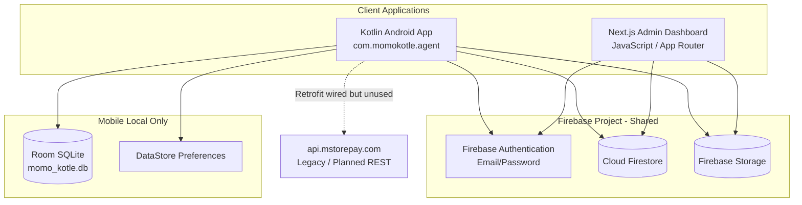
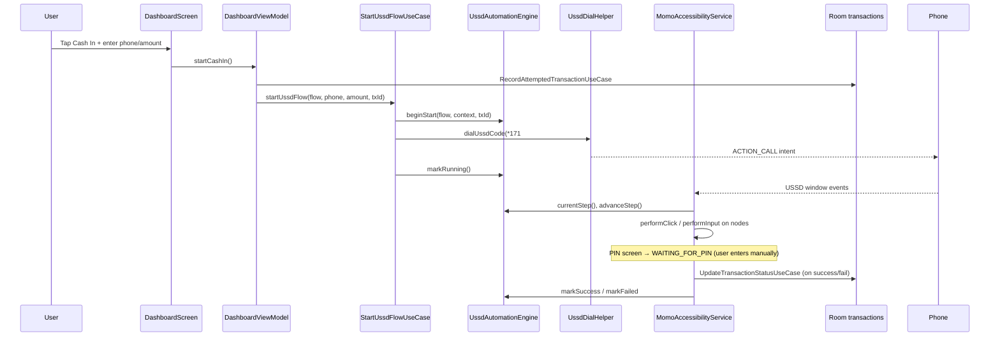
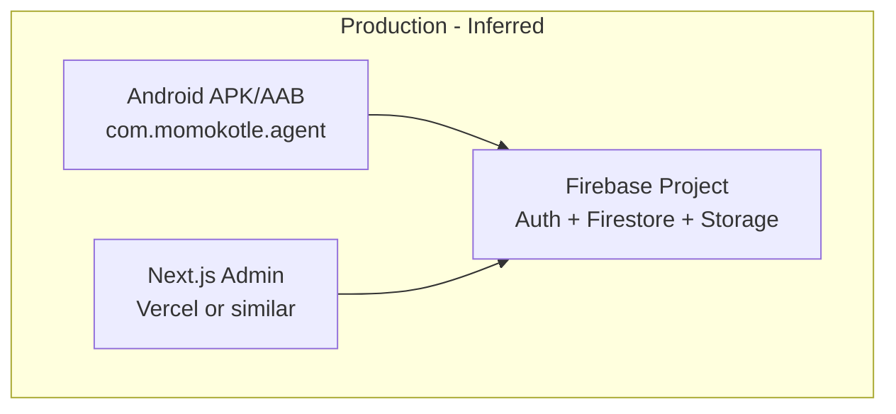
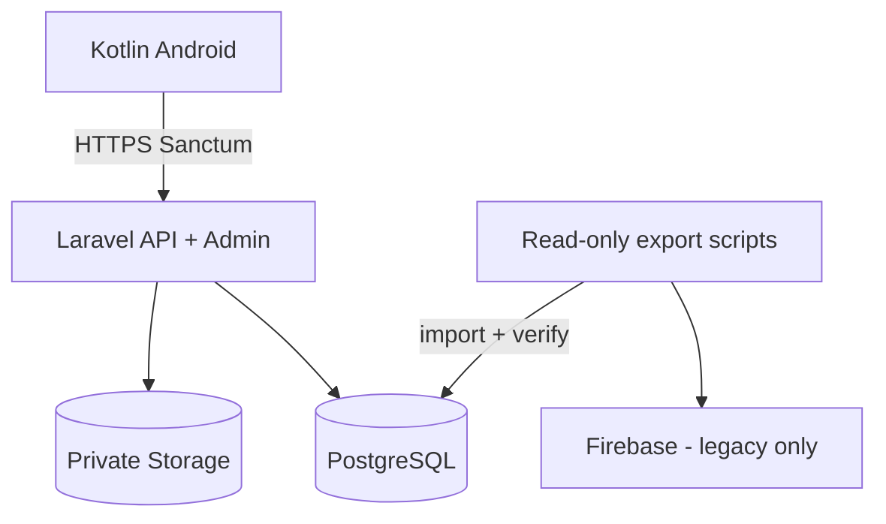

# MoMo Kotle — Technical Architecture

This document describes the **existing** MoMo Kotle system as implemented in this repository. It is based on direct inspection of source code, configuration, and documentation — not assumptions about intended future architecture.

---

## 1. Project Overview

MoMo Kotle is a **Mobile Money agent automation platform** for Ghana, consisting of:

| Component | Purpose |
|-----------|---------|
| **Android mobile app** (`app/`) | Agent-facing app for USSD automation (MTN MoMo), transaction history, commission tracking, store orders, agent registration forms, referrals, wallets, and subscriptions |
| **Admin dashboard** (`admin-dashboard/`) | Web admin UI for managing users, products, orders, form submissions, commissions, withdrawals, revenue, and business settings |

Both components share a **single Firebase project** (Firestore, Auth, Storage). There is **no custom backend server** in this repository, and **PostgreSQL is not currently implemented**.

The Gradle root project name is `MStorepay`; the Android application ID is `com.momokotle.agent`.

---

## 2. Repository Structure

```
momo-kotle/
├── app/                          # Kotlin Android application
│   ├── src/main/java/com/momokotle/agent/
│   │   ├── accessibility/        # MomoAccessibilityService (USSD automation)
│   │   ├── data/                 # DataStore, Firestore, remote API stubs, form config
│   │   ├── database/             # Room DB, DAOs, entities
│   │   ├── di/                   # Hilt modules
│   │   ├── domain/               # Repositories (interfaces), use cases, engines
│   │   ├── models/               # Domain/data models
│   │   ├── presentation/         # Compose screens, ViewModels, navigation
│   │   ├── repository/           # Repository implementations
│   │   ├── ussd/                 # USSD flow definitions and automation engine
│   │   ├── ui/                   # Theme and shared Compose components
│   │   └── utils/                # Formatters, validators, logging
│   ├── src/test/                 # Unit tests (JUnit 4)
│   ├── build.gradle.kts
│   ├── FIREBASE_SETUP.md
│   └── google-services.json      # Gitignored; placeholder may exist locally
├── admin-dashboard/              # Next.js admin web app
│   ├── app/                      # App Router pages
│   ├── components/               # UI, layout, auth, shared
│   ├── firebase/                 # Firebase init and auth helpers
│   ├── hooks/                    # useAuth context
│   ├── lib/                      # Utils, Zod validators
│   ├── services/                 # Firestore/Storage service layer
│   └── utils/                    # Constants, formatters, export
├── gradle/                       # Gradle wrapper
├── build.gradle.kts              # Root Gradle plugins
├── settings.gradle.kts           # Single module: :app
├── gradle.properties
├── gradle/libs.versions.toml     # Version catalog
├── firestore.rules.example       # Example Firestore security rules
├── storage.rules.example         # Example Storage security rules
└── docs/                         # Architecture documentation (this file)
```

**Not present in the repository:**

- Django, Express, or other API server
- PostgreSQL, Prisma, or SQL migrations
- Docker / Kubernetes deployment configs
- CI/CD pipeline definitions
- Committed `.env` or `.env.example` files (admin README references `.env.example` but it is not in the repo)
- Committed `google-services.json` (listed in `.gitignore`)

---

## 3. System Architecture

Mobile and admin communicate **only through Firebase** — there is no shared REST/GraphQL backend in active use.



**Actual data path:**

```
Kotlin Mobile  ──►  Firebase (Auth + Firestore + Storage)  ◄──  Next.js Admin
```

The mobile app defines a Retrofit client (`MStorepayApiService`) pointing at `https://api.mstorepay.com/`, but **no repository or use case injects or calls it**. All online operations use the Firebase SDK directly.

---

## 4. Mobile Architecture

### 4.1 Entry Point and Application Bootstrap

| Item | Location |
|------|----------|
| Application class | `MomoAgentApplication` — `@HiltAndroidApp`, seeds Room defaults via `DatabaseInitializer` |
| Activity | `MainActivity` — Compose host, session routing |
| Manifest | `AndroidManifest.xml` — permissions, accessibility service declaration |

**Session routing in `MainActivity`:**

1. Loading → `AppLoadingState`
2. Authenticated → `MomoNavHost` + `MomoBottomBar`
3. Unauthenticated → `AuthNavHost` (login/register)

### 4.2 Architecture Pattern

The mobile app follows **Clean Architecture** with clear layer separation:

| Layer | Package | Responsibility |
|-------|---------|----------------|
| **Presentation** | `presentation/*` | Compose UI, ViewModels, Navigation |
| **Domain** | `domain/*` | Repository interfaces, use cases, `AgentCommissionEngine` |
| **Data** | `data/*`, `database/*`, `repository/*` | Firestore, Room, DataStore, repository implementations |

**Dependency injection:** Dagger Hilt (`di/AppModule.kt`, `di/FirebaseModule.kt`, `di/NetworkModule.kt`, `RepositoryModule`)

**State management:** Kotlin `StateFlow` / `Flow` in ViewModels; Compose `collectAsStateWithLifecycle`

### 4.3 Package Structure

```
com.momokotle.agent/
├── accessibility/     MomoAccessibilityService
├── data/
│   ├── catalog/       Static catalog data
│   ├── datastore/     SettingsDataStore, UserAccountDataStore, ReferralDataStore
│   ├── firestore/     All Firestore data sources and mappers
│   ├── form/          Form field definitions, document slots
│   ├── local/         DatabaseInitializer
│   └── remote/        MStorepayApiService (unused)
├── database/          Room AppDatabase, DAOs, entities
├── di/                Hilt modules
├── domain/
│   ├── engine/        AgentCommissionEngine (local MoMo commission calc)
│   ├── repository/    Repository interfaces
│   └── usecase/       Use cases (USSD, contacts, transactions, commission)
├── models/            Enums, data classes, business models
├── presentation/      Screens by feature area
├── repository/        Repository implementations
├── ussd/              Flow definitions, automation engine, dial helper
├── ui/                Theme, shared components
└── utils/             Phone/amount formatters, validators, logging
```

### 4.4 Navigation

**Auth flow** (`AuthNavHost`): Login → Register

**Main flow** (`MomoNavHost`, start: `HOME`):

| Route | Screen | Purpose |
|-------|--------|---------|
| `HOME` | Dashboard | USSD transaction launcher |
| `STORE` | Store | Browse/purchase products |
| `AGENT_REGISTRATION` | Agent registration hub | Form type selection |
| `HISTORY` | Transactions | Local transaction history |
| `SETTINGS` | Settings hub | Profile, profit rules, contacts |
| `CUSTOM_FLOWS` | Custom flow list | User-defined USSD menus |
| `REFERRAL`, `WALLET`, `SUBSCRIPTION`, `NOTIFICATIONS` | Business features | Referral program, wallet, plans |
| `MY_ORDERS`, `MY_SUBMISSIONS` | User data | Orders and form submissions |

Bottom tabs (`MomoBottomBar`): Home, Store, Agent Registration, History, Settings.

### 4.5 Key ViewModels and Use Cases

| Feature | ViewModel | Key Use Cases / Repositories |
|---------|-----------|------------------------------|
| Dashboard / USSD | `DashboardViewModel` extends `BaseUssdViewModel` | `StartUssdFlowUseCase`, `RecordAttemptedTransactionUseCase`, `SaveContactUseCase` |
| Custom USSD | `CustomFlowViewModel` | `CustomFlowRepository`, same USSD use cases |
| Auth | `LoginViewModel`, `SessionViewModel` | `AuthRepository` |
| Store | `StoreViewModel` | `ProductRepository`, `OrderRepository` |
| Transactions | `TransactionsViewModel` | `TransactionRepository` |
| Referral / Wallet / Subscription | Feature ViewModels | Firestore-backed business repositories |
| Agent forms | Registration ViewModels | `FormSubmissionRepository`, `FirebaseSubmissionStorage` |

### 4.6 Local Persistence

#### Room Database (`momo_kotle.db`, version 12)

| Table | Entity | Purpose |
|-------|--------|---------|
| `transactions` | `TransactionEntity` | USSD transaction attempts and outcomes |
| `profit_rules` | `ProfitRuleEntity` | Tiered cash-in/cash-out commission rules |
| `saved_contacts` | `SavedContactEntity` | Quick-dial contact book |
| `custom_flows` | `CustomFlowEntity` | User-defined USSD step sequences |
| `store_orders` | `StoreOrderEntity` | Cached store orders (synced from Firestore) |
| `form_submissions` | `FormSubmissionEntity` | Cached agent registration submissions |
| `store_products` | `StoreProductEntity` | Cached product catalog |

Migration strategy: `fallbackToDestructiveMigration()` — schema changes wipe local data.

#### DataStore Preferences

| Store | File | Keys |
|-------|------|------|
| `SettingsDataStore` | `momo_settings` | Automation speed, SIM slot mapping, profit calculation modes, dark theme, transaction verification |
| `UserAccountDataStore` | User profile cache | Cached `UserProfile` for offline display |
| `ReferralDataStore` | Referral UI state | Local referral-related preferences |

### 4.7 Remote Data Access

All active remote access uses **Firebase SDK** (not Retrofit):

| Data Source Class | Firestore Collection(s) |
|-------------------|---------------------------|
| `FirestoreUserDataSource` | `users` |
| `FirestoreProductDataSource` | `storeProducts` |
| `FirestoreOrderDataSource` | `storeOrders` |
| `FirestoreFormSubmissionDataSource` | `form_submissions`, `formSubmissions` (legacy) |
| `FirestoreWalletDataSource` | `wallets`, `wallet_transactions`, `subscriptions`, `withdrawal_requests`, `payments` |
| `FirestoreReferralDataSource` | `referrals`, `notifications` |
| `FirestoreBusinessSettingsDataSource` | `business_settings`, `subscription_plans` |
| `BusinessRegistrationService` | Atomic registration across `users`, `wallets`, `referrals`, `notifications` |
| `FirebaseSubmissionStorage` | Storage path `agent_uploads/{userId}/{submissionId}/{fileName}` |

**Sync pattern:** Repositories for orders, products, and form submissions observe Firestore snapshots and cache to Room (`startSync` / `stopSync` on login/logout).

### 4.8 Authentication (Mobile)

- **Provider:** Firebase Auth (email/password)
- **Flow:** `AuthRepositoryImpl` wraps Firebase Auth + Firestore user profile
- **Registration:** Creates Firebase user, then `BusinessRegistrationService.registerUserWithBusinessSetup()` atomically creates user doc, wallet, optional referral link, and referrer notification
- **Trial:** New users receive `subscriptionStatus: Trial` with configurable trial days from `business_settings/global`
- **Suspension:** `accountStatus` checked on login; suspended users are signed out
- **Caching:** Profile cached in `UserAccountDataStore`

### 4.9 Subscription Access Control

`UserProfile.accessLevel` / `SubscriptionAccessGate` gates premium features:

| Access Level | Condition |
|--------------|-----------|
| `FULL` | Active trial or active paid subscription |
| `SUBSCRIPTION_REQUIRED` | Expired trial or subscription |
| `LIMITED` | Default for users without trial/subscription |

Store, referrals, and related features use `SubscriptionAccessGate` composable.

---

## 5. Admin Architecture

### 5.1 Framework and Routing

| Item | Value |
|------|-------|
| Framework | Next.js **16.2.6** (App Router) |
| Language | **JavaScript only** (`.js` / `.jsx`) — no TypeScript |
| React | **19.2.4** |
| Styling | Tailwind CSS **v4**, shadcn/ui (Radix primitives) |
| Forms | React Hook Form + Zod |
| Charts | Recharts |
| Middleware | **None** — auth enforced client-side in `DashboardShell` |

### 5.2 Layout Architecture

```
app/layout.js          Root layout + AuthProvider (Firebase auth context)
app/login/page.js      Public login page
app/dashboard/layout.js → DashboardShell (sidebar + topbar + auth guard)
app/dashboard/*/page.js Feature pages
```

**Auth guard:** `DashboardShell` redirects to `/login` if `!user || !isAdmin`. No server-side route protection.

### 5.3 Authentication and Authorization

| Mechanism | Implementation |
|-----------|----------------|
| Sign-in | Firebase Auth email/password via `loginAdmin()` |
| Admin check | Document must exist at `admins/{firebaseAuthUid}` |
| Non-admin rejection | Immediate `signOut()` + error message |
| Session | `onAuthStateChanged` listener in `useAuth` hook |
| Roles | Optional `role` field on admin doc; not enforced beyond existence check |

### 5.4 Service Layer

Each admin feature has a dedicated service module under `admin-dashboard/services/`:

| Service | Firestore Collections Used |
|---------|---------------------------|
| `users.js` | `users` |
| `products.js` | `storeProducts` + Storage `products/{id}/` |
| `orders.js` | `storeOrders` |
| `submissions.js` | `form_submissions`, `formSubmissions` (legacy) |
| `wallets.js` | `wallets`, `wallet_transactions` |
| `withdrawals.js` | `withdrawal_requests`, `wallets` |
| `subscriptions.js` | `subscriptions`, `users` |
| `subscriptionPlans.js` | `subscription_plans` |
| `referrals.js` | `referrals` |
| `commissions.js` | `commission_transactions` |
| `revenue.js` | `revenue_transactions` |
| `commissionEngine.js` | Multi-collection transactional commission processing |
| `businessSettings.js` | `business_settings/global` |
| `settings.js` | `appSettings/global` |
| `notifications.js` | `notifications` |
| `auditLog.js` | `audit_log` |
| `reports.js` | Aggregates from orders, submissions |
| `storage.js` | Firebase Storage helpers |

### 5.5 Admin Pages

Navigation defined in `utils/constants.js` (`NAV_ITEMS`):

Dashboard, Store Management, Form Management (5 form types + all), Document Center, Users/Agents, Referrals, Wallets, Subscription Plans, Active Subscriptions, Commissions, Withdrawals, Revenue, Business Settings, Reports, Notifications, Audit Log, Settings.

### 5.6 Typical Admin Flow

```
Admin action (page)
    ↓
Page component (client component)
    ↓
Service function (services/*.js)
    ↓
Firebase SDK (Firestore / Storage)
    ↓
Shared Firestore collection
    ↓
UI update (React state)
```

**Example — order commission:**

```
Order marked "Delivered"
    ↓
orders page calls processOrderCommission(orderId)
    ↓
commissionEngine.js runTransaction:
    - Read order + product + referrer from users
    - Credit referrer wallet
    - Write wallet_transactions, commission_transactions
    - Write revenue_transactions (system share)
    - Write notification
    - Set order.commissionProcessed = true
```

---

## 6. Backend/API Architecture

**There is no backend server in this repository.**

| Aspect | Status |
|--------|--------|
| Django / Node API | Not present |
| PostgreSQL | **Not currently implemented** |
| REST API (active) | Not used |
| REST API (defined) | `MStorepayApiService` at `https://api.mstorepay.com/` — wired in Hilt but **never called** |
| GraphQL | Not present |

The `MStorepayApiService` interface defines:

- `POST api/v1/orders`
- `POST api/v1/forms`
- `POST api/v1/forms/{submissionId}/documents`

These endpoints appear to be **legacy or planned** infrastructure. Current implementations write directly to Firestore and Firebase Storage.

---

## 7. Database Architecture

### 7.1 Cloud Database — Firestore

PostgreSQL is not used. All shared persistent data lives in **Cloud Firestore**.

#### Collections

| Collection | Document ID | Primary Owner | Key Fields |
|------------|-------------|---------------|------------|
| `admins` | Firebase Auth UID | Admin dashboard | `email`, `role?` |
| `users` | Firebase Auth UID | Both | Profile, referral, trial/subscription fields |
| `counters` | `submission_{date}` | Mobile | Auto-increment for submission IDs |
| `storeProducts` | Auto / manual | Admin writes, mobile reads | `productName`, `price`, `profit`, `referralPercent`, `systemPercent`, `stockQuantity`, `isAvailable`, `productImageUrl` |
| `storeOrders` | UUID | Mobile creates, admin updates | `userId`, `itemName`, `quantity`, `totalAmount`, `status`, `commissionProcessed` |
| `form_submissions` | `SUB{date}{seq}` | Mobile creates, admin reviews | `userId`, `formType`, `formData`, `documents`, `status`, `adminNote` |
| `formSubmissions` | Legacy | Read-only fallback | Same purpose, older collection name |
| `appSettings` | `global` | Admin | Store/forms toggles, support contact, share link |
| `business_settings` | `global` | Admin | Commission splits, trial days, min withdrawal, feature flags |
| `subscription_plans` | Auto | Admin | `planName`, `price`, `durationDays`, `status` |
| `subscriptions` | UUID | Mobile creates, admin manages | `userId`, `planId`, dates, `status`, payment info |
| `wallets` | User ID | Both | `availableBalance`, `pendingBalance`, `withdrawnBalance`, `lifetimeEarnings` |
| `wallet_transactions` | UUID | Both | `userId`, `amount`, `source`, `status`, `reference` |
| `commission_transactions` | UUID | Admin engine | Referral commission breakdown per order |
| `revenue_transactions` | UUID | Admin engine | System revenue share |
| `referrals` | UUID | Mobile (on registration) | `referrerUserId`, `referredUserId`, stats |
| `withdrawal_requests` | UUID | Mobile creates, admin approves | `amount`, `paymentMethod`, `status` |
| `payments` | UUID | Mobile | Subscription/order payment records |
| `notifications` | UUID | Both | `userId`, `title`, `message`, `type`, `isRead` |
| `audit_log` | Auto | Admin | Admin action audit trail |

#### Conceptual Data Relationships

```
USER (users/{uid})
 ├── WALLET (wallets/{uid})
 │     └── WALLET_TRANSACTIONS (wallet_transactions/*)
 ├── SUBSCRIPTIONS (subscriptions/*)
 ├── PAYMENTS (payments/*)
 ├── STORE_ORDERS (storeOrders/*)
 ├── FORM_SUBMISSIONS (form_submissions/*)
 │     └── DOCUMENTS → Storage: agent_uploads/{uid}/{submissionId}/*
 ├── REFERRALS — as referrer (referrals/* where referrerUserId = uid)
 ├── REFERRALS — as referred (referrals/* where referredUserId = uid)
 └── NOTIFICATIONS (notifications/* where userId = uid)

ADMIN (admins/{uid}) — separate auth gate, not linked to users

STORE_PRODUCT (storeProducts/*)
 └── referenced by STORE_ORDERS (itemName / productId)

SUBSCRIPTION_PLAN (subscription_plans/*)
 └── referenced by SUBSCRIPTIONS (planId)

BUSINESS_SETTINGS (business_settings/global) — global config
APP_SETTINGS (appSettings/global) — app feature toggles

ORDER (storeOrders/*) — when Delivered:
 ├── COMMISSION_TRANSACTION (commission_transactions/*)
 ├── REVENUE_TRANSACTION (revenue_transactions/*)
 └── WALLET_TRANSACTION for referrer
```

### 7.2 Local Database — Room (Mobile Only)

See Section 4.6. Room is a **device-local cache and offline store** for USSD transactions, contacts, profit rules, and synced Firestore data. It is not shared with the admin dashboard.

### 7.3 Indexes

No index definition files are committed. Firebase Console may require composite indexes for queries such as:

- `storeProducts` ordered by `createdAt`
- `storeOrders` filtered by `userId`
- `form_submissions` filtered by `userId` / `formType` / `status`

---

## 8. Storage Architecture

### 8.1 Firebase Storage Paths

| Path | Writer | Reader | Purpose |
|------|--------|--------|---------|
| `agent_uploads/{userId}/{submissionId}/{fileName}` | Mobile agent | Agent + admin | Registration form documents |
| `submissions/{submissionId}/{fileName}` | Legacy | Admin | Older upload path |
| `products/{productId}/{fileName}` | Admin | All authenticated | Product images |

### 8.2 Document Upload Flow (Mobile)

```
User picks file on form screen
    ↓
FormSubmissionRepository.uploadDocumentSlot()
    ↓
FirebaseSubmissionStorage → Storage (immediate upload)
    ↓
URL stored in form state (documents.{slotId}Url)
    ↓
On submit: Firestore doc created in form_submissions
    (URLs only — files never stored in Firestore)
```

Submission IDs generated via `counters` collection: format `SUB202606210001`.

---

## 9. Authentication Architecture

```mermaid
flowchart LR
    subgraph mobile_auth [Mobile Agent Auth]
        MA[Email/Password] --> FA[Firebase Auth]
        FA --> UP[users/{uid} profile]
    end

    subgraph admin_auth [Admin Auth]
        AA[Email/Password] --> FA2[Firebase Auth]
        FA2 --> AD{admins/{uid} exists?}
        AD -->|Yes| Dash[Dashboard Access]
        AD -->|No| Deny[Sign out + Access Denied]
    end
```

| Concern | Mobile | Admin |
|---------|--------|-------|
| Provider | Firebase Auth | Firebase Auth |
| Identity | `users` collection | `admins` collection |
| Authorization | Firestore security rules + subscription gating | Client-side admin doc check |
| Session | Firebase Auth state + cached profile | Firebase Auth state + admin flag |

---

## 10. Mobile ↔ Backend/Admin Data Flow

Both clients read and write the **same Firestore collections**. There is no message queue or event bus between them.

| Data Type | Mobile | Admin | Shared Collection |
|-----------|--------|-------|-------------------|
| User profiles | Read/write own | Read/write all | `users` |
| Products | Read (realtime) | CRUD | `storeProducts` |
| Orders | Create own | Read/update status | `storeOrders` |
| Form submissions | Create own | Approve/reject | `form_submissions` |
| Wallets | Read own, request withdrawal | Read all, approve withdrawals | `wallets`, `withdrawal_requests` |
| Subscriptions | Purchase | Manage | `subscriptions`, `subscription_plans` |
| Referrals | View own | View all | `referrals` |
| Notifications | Read/mark read | Create broadcast | `notifications` |
| Business settings | Read | Write | `business_settings` |
| App settings | Read | Write | `appSettings` |
| USSD transactions | **Local Room only** | Not visible | N/A |
| MoMo agent commission | **Local Room only** | Not visible | N/A |

**Important distinction:** USSD transaction history and local MoMo commission calculations (`AgentCommissionEngine`) are **device-local** and do not sync to Firebase. Referral/order commissions (`commissionEngine.js`) are a separate, cloud-based system tied to store orders.

---

## 11. USSD Automation Architecture

### 11.1 Overview

The core feature automates MTN MoMo USSD menus (`*171#`) using Android's **AccessibilityService** to read USSD dialog text and programmatically click buttons / enter values.



### 11.2 Flow Definition

Predefined flows in `UssdFlows.kt`:

| Flow | USSD Code | Transaction Type | Steps Summary |
|------|-----------|------------------|---------------|
| Cash In | `*171#` | `MTN_CASHIN` | Menu 3→1, phone×2, amount, stop for PIN |
| Cash Out | `*171#` | `MTN_CASHOUT` | Menu 2→1, phone×2, amount, stop for PIN |
| Pay to Merchant | `*171#` | `AGENT_MERCHANT` | Menu 1→1, phone×2, amount, stop for PIN |
| Transfer Airtime | `*171#` | `MTN_AIRTIME` | Menu 5→1→5, phone×2, amount, stop for PIN |
| Balance | `*171#` | `BALANCE` | Menu 6, stop for PIN |
| Commission | `*171#` | `COMMISSION` | Menu 7, stop for PIN |
| EVD/Just4U | `*171#` | `EVD_JUST4U` | Menu 8, stop for PIN |
| Custom | User-defined | `CUSTOM` | From `CustomFlowEntity` via `CustomFlowMapper` |

Each step is a `UssdStep` with `UssdActionType`: `CLICK`, `INPUT`, `WAIT`, `STOP_FOR_USER`.

### 11.3 Automation Engine States

`AutomationStatus` lifecycle: `IDLE` → `STARTING` → `DIALING` → `RUNNING` → (`WAITING_FOR_PIN`) → `SUCCESS` | `FAILED` | `TIMEOUT` | `CANCELLED` → `IDLE`

### 11.4 Accessibility Service Behavior

`MomoAccessibilityService`:

1. Listens for `TYPE_WINDOW_STATE_CHANGED` and `TYPE_WINDOW_CONTENT_CHANGED`
2. Debounces events (300ms)
3. Requires screen text stability (2 consecutive identical reads)
4. Validates screen against step `expectedText` hints
5. Performs click/input via `AccessibilityNodeInfo` actions
6. Detects PIN screens via `UssdSecurityHelper` — stops automation, waits for user
7. Analyzes result text via `TransactionVerificationAnalyzer` (keyword matching)
8. Times out after 120 seconds

### 11.5 Commission / Profit Calculation (Local MoMo)

On successful USSD transaction (when verification enabled):

```
UpdateTransactionStatusUseCase
    ↓
CalculateVendorProfitUseCase
    ↓
AgentCommissionEngine.calculateForTransaction(type, amount)
    ↓
Uses AppSettings (DataStore) + ProfitRuleEntity (Room tiers)
    ↓
Updates TransactionEntity.commission + commissionRuleUsed
```

This is **agent MoMo commission estimation** (cash-in/cash-out tiers), separate from **referral order commissions** processed in the admin dashboard.

### 11.6 Required Permissions

| Permission | Purpose |
|------------|---------|
| `CALL_PHONE` | Dial USSD via `Intent.ACTION_CALL` |
| `READ_PHONE_STATE` | SIM slot selection |
| `INTERNET` | Firebase sync |
| `ACCESS_NETWORK_STATE` | Online checks |
| Accessibility Service (user-enabled) | USSD dialog automation |

---

## 12. Major Feature Architecture

### 12.1 User Registration

```
RegisterScreen → LoginViewModel.register()
    ↓
Firebase Auth createUserWithEmailAndPassword
    ↓
BusinessRegistrationService.registerUserWithBusinessSetup()
    ↓
Firestore transaction: users + wallets + referrals? + notifications?
    ↓
UserAccountDataStore.saveProfile()
```

### 12.2 Store Order

```
StoreScreen → StoreViewModel.placeOrder()
    ↓
OrderRepositoryImpl.placeOrder()
    ↓
Room insert (optimistic) → FirestoreOrderDataSource.createOrder()
    ↓
Admin updates status in dashboard → Firestore snapshot syncs back to Room
    ↓
When Delivered: admin runs processOrderCommission()
```

### 12.3 Agent Form Submission

```
AgentFormScreen → upload documents to Storage on pick
    ↓
FormSubmissionRepository.createAndSubmitForm()
    ↓
Firestore form_submissions doc + Room cache
    ↓
Admin reviews in submissions page → approve/reject → syncs to mobile
```

### 12.4 Subscription Purchase

```
SubscriptionScreen → SubscriptionViewModel
    ↓
BusinessRepositoryImpl (Firestore transaction)
    ↓
Creates: subscriptions doc, payments doc, updates users subscription fields
    ↓
Optional: referral subscription bonus to referrer wallet
```

### 12.5 Withdrawal Request

```
WalletScreen → request withdrawal
    ↓
Firestore withdrawal_requests (status: Pending)
    ↓
Admin withdrawals page → approve/reject/paid
    ↓
Wallet balance adjusted via Firestore transaction
```

---

## 13. Security Architecture

### 13.1 Firestore Security Rules

Example rules in `firestore.rules.example`:

- **`isAdmin()`** — authenticated user with `admins/{uid}` document
- **`isOwner(userId)`** — authenticated user matches document owner
- Users can read/write own data with field-level restrictions on sensitive referral/subscription fields
- Admin-only write on products, business settings, commission/revenue collections
- **`admins` collection:** read own doc only; **write disabled** (must be created via Firebase Console/scripts)

**Gap:** `audit_log` collection is used by admin dashboard but **not covered** in `firestore.rules.example`.

### 13.2 Storage Security Rules

Example rules in `storage.rules.example`:

- Agents upload to own `agent_uploads/{userId}/...` path
- Admins can read all agent uploads (via Firestore cross-service rule check)
- Product images: authenticated read, admin write

### 13.3 Secrets and Configuration

| File | Status | Notes |
|------|--------|-------|
| `google-services.json` | Gitignored | Required for Android Firebase; placeholder mentioned in `FIREBASE_SETUP.md` |
| `admin-dashboard/.env*` | Gitignored | Firebase web config via `NEXT_PUBLIC_FIREBASE_*` env vars |
| `local.properties` | Gitignored | Android SDK path |
| `BuildConfig.API_BASE_URL` | In source | `https://api.mstorepay.com/` — public URL, not a secret |

**Note:** README references `.env.example` for admin dashboard but this file is **not committed**. Developers must create `.env.local` manually from Firebase Console values.

### 13.4 Sensitive Data Handling

- PIN/password screens: automation pauses; PIN values are never logged (`AutomationLogger` + `UssdSecurityHelper`)
- USSD screen text with PIN keywords is excluded from transaction verification analysis
- Firebase API keys in client apps are expected public identifiers (restricted by Firebase security rules)

### 13.5 Android Security Considerations

- Accessibility service has broad screen access — required for USSD automation
- `allowBackup="true"` in manifest — may expose local Room data in backups
- Release builds use ProGuard (`isMinifyEnabled = true`)

---

## 14. Configuration

### 14.1 Mobile (`app/build.gradle.kts`)

| Setting | Value |
|---------|-------|
| `applicationId` | `com.momokotle.agent` |
| `minSdk` | 26 |
| `targetSdk` / `compileSdk` | 34 |
| `versionName` | 1.0.0 |
| `API_BASE_URL` | `https://api.mstorepay.com/` |
| JVM target | 17 |

### 14.2 Admin (`admin-dashboard/`)

Environment variables (expected in `.env.local`):

- `NEXT_PUBLIC_FIREBASE_API_KEY`
- `NEXT_PUBLIC_FIREBASE_AUTH_DOMAIN`
- `NEXT_PUBLIC_FIREBASE_PROJECT_ID`
- `NEXT_PUBLIC_FIREBASE_STORAGE_BUCKET`
- `NEXT_PUBLIC_FIREBASE_MESSAGING_SENDER_ID`
- `NEXT_PUBLIC_FIREBASE_APP_ID`

### 14.3 Firebase Setup

See `app/FIREBASE_SETUP.md` and `admin-dashboard/README.md` for:

- Shared Firebase project setup
- Enabling Auth, Firestore, Storage
- Deploying rules from example files
- Creating admin documents in `admins` collection

---

## 15. Dependencies

### A. Mobile Application Stack

| Technology | Version | Where Used | Responsibility |
|------------|---------|------------|----------------|
| Kotlin | 2.0.21 | All mobile code | Primary language |
| Android Gradle Plugin | 8.5.1 | Build | Android build system |
| Jetpack Compose | BOM 2024.02.01 | UI | Declarative UI |
| Material 3 | (via BOM) | UI | Design system |
| Navigation Compose | 2.7.7 | `presentation/navigation` | Screen routing |
| Hilt | 2.51.1 | `di/`, ViewModels | Dependency injection |
| Room | 2.6.1 | `database/` | Local SQLite ORM |
| DataStore Preferences | 1.0.0 | `data/datastore/` | Key-value preferences |
| Firebase BOM | 33.7.0 | Auth, Firestore, Storage | Backend services |
| Retrofit | 2.9.0 | `data/remote/` | HTTP client (unused) |
| OkHttp | 4.12.0 | Network module | HTTP transport |
| Gson | 2.10.1 | Serialization | JSON parsing |
| Coroutines | 1.7.3 | Throughout | Async operations |
| Coil | 2.6.0 | Image loading | Product images |
| Lifecycle / ViewModel | 2.7.0 | ViewModels | UI lifecycle |

### B. Admin Dashboard Stack

| Technology | Version | Where Used | Responsibility |
|------------|---------|------------|----------------|
| Next.js | 16.2.6 | `app/` | React framework, App Router |
| React | 19.2.4 | Components | UI library |
| JavaScript | — | All admin code | No TypeScript |
| Tailwind CSS | 4.x | Styling | Utility CSS |
| Radix UI | Various | `components/ui/` | Accessible primitives (shadcn) |
| Firebase JS SDK | 11.9.0 | `firebase/` | Auth, Firestore, Storage |
| React Hook Form | 7.56.4 | Forms | Form state |
| Zod | 3.25.28 | `lib/validators.js` | Schema validation |
| Recharts | 2.15.3 | Reports | Charts |
| Lucide React | 0.511.0 | Icons | Icon set |

### C. Backend/API Stack

**Not implemented in repository.** Retrofit client exists on mobile but is unused.

### D. Database Stack

| Technology | Where | Role |
|------------|-------|------|
| Cloud Firestore | Firebase | Primary shared database |
| Room (SQLite) | Android device | Local cache + USSD data |
| DataStore | Android device | User preferences |

**PostgreSQL is not currently implemented in the repository.**

### E. File/Storage Stack

| Technology | Where | Role |
|------------|-------|------|
| Firebase Storage | Cloud | Document uploads, product images |

### F. Authentication Stack

| Technology | Where | Role |
|------------|-------|------|
| Firebase Auth (Email/Password) | Mobile + Admin | User identity |
| Firestore `admins` collection | Admin gate | Admin authorization |

### G. Third-Party Services

| Service | Usage |
|---------|-------|
| Firebase (Google) | Auth, Firestore, Storage — sole backend |
| MTN USSD (`*171#`) | Mobile money operations via telephony |
| api.mstorepay.com | Defined but not actively used |

### H. Development/Build Tools

| Tool | Platform |
|------|----------|
| Gradle + Version Catalog | Android |
| npm | Admin dashboard |
| ESLint 9 + eslint-config-next | Admin linting |
| KAPT | Room + Hilt code generation |

### I. Testing Tools

| Tool | Where | Coverage |
|------|-------|----------|
| JUnit 4 | `app/src/test/` | 5 unit test files: commission engine, business name validator, referral code generator, user business profile |
| AndroidJUnit runner | Configured | No instrumented tests found in source |

**Admin dashboard:** No test framework configured.

### J. Deployment/Hosting

| Component | Expected Hosting | In Repo |
|-----------|------------------|---------|
| Android app | Google Play / sideload APK | Gradle assemble tasks only |
| Admin dashboard | Vercel-compatible (Next.js) | `npm run build` / `npm start` |
| Firebase rules | Firebase CLI deploy | Example files only |
| Backend API | Unknown external host | Not in repo |

---

## 16. Build and Run Instructions

### 16.1 Android Mobile App

**Prerequisites:** Android Studio, JDK 17, Firebase project with `google-services.json` in `app/`

```bash
# From repository root
./gradlew :app:assembleDebug

# Run unit tests
./gradlew :app:testDebugUnitTest
```

**Device requirements:**

- Enable Accessibility Service for the app (Settings → Accessibility)
- Grant `CALL_PHONE` permission
- Active SIM with MTN MoMo for USSD testing

### 16.2 Admin Dashboard

```bash
cd admin-dashboard
npm install

# Create .env.local with NEXT_PUBLIC_FIREBASE_* variables
npm run dev     # http://localhost:3000
npm run build   # Production build
npm start       # Production server
```

**Admin setup:** Create Firebase Auth user + matching document in `admins/{uid}`.

### 16.3 Firebase Rules Deployment

```bash
# Copy and customize example files, then:
firebase deploy --only firestore
firebase deploy --only storage
```

---

## 17. Testing Architecture

| Layer | Mobile | Admin |
|-------|--------|-------|
| Unit tests | 5 Kotlin test files | None |
| Integration tests | None committed | None |
| E2E tests | None | None |
| Manual testing | USSD requires physical device + SIM | Browser + Firebase project |

Existing mobile unit tests cover:

- `AgentCommissionEngine` / commission calculator
- `BusinessNameValidator`
- `ReferralCodeGenerator`
- `UserBusinessProfile.resolveAccessLevel()`

---

## 18. Deployment Architecture



No deployment scripts, Dockerfiles, or CI pipelines exist in the repository. Firebase rules must be deployed separately via Firebase CLI.

---

## 19. Known Architectural Issues

1. **Unused REST API layer** — `MStorepayApiService` and Retrofit are fully wired in DI but never injected into any repository. Creates confusion about the actual data path.

2. **Dual form submission collection names** — `form_submissions` (current) and `formSubmissions` (legacy). Both mobile and admin read from both; increases query complexity.

3. **Destructive Room migrations** — `fallbackToDestructiveMigration()` wipes all local USSD transaction history on schema upgrade.

4. **Admin auth is client-side only** — No Next.js middleware or server components enforce admin access. Firestore rules are the real enforcement layer.

5. **`audit_log` missing from security rules example** — Admin writes audit entries but `firestore.rules.example` has no match block for `audit_log`.

6. **Missing `.env.example`** — Admin README references it but file is not committed; onboarding friction.

7. **Commission systems are separate** — Local MoMo agent commission (Room/`AgentCommissionEngine`) vs cloud referral commission (`commissionEngine.js`) use different models and are not reconciled.

8. **USSD fragility** — Menu option numbers (e.g., "3" for Cash In) are hardcoded; MTN menu changes break automation.

9. **Root project name mismatch** — Gradle project named `MStorepay` vs product name MoMo Kotle.

---

## 20. Current Limitations

- USSD automation requires manual Accessibility Service enablement and PIN entry
- USSD transaction data does not sync to cloud — admin cannot see agent MoMo activity
- No offline support for store orders, form submissions, or wallet operations (network required)
- No push notifications (FCM not integrated despite Firebase project)
- No multi-language support
- Admin dashboard has no role-based permissions beyond admin/non-admin
- No automated test coverage for admin or integration flows
- Single Firebase project dependency — no staging environment defined in repo

---

## 21. Areas That Should NOT Be Changed Without Understanding Dependencies

| Area | Why |
|------|-----|
| **Firestore collection names** | Both mobile (`FirestoreCollections`) and admin (`utils/constants.js`) must stay in sync |
| **`form_submissions` vs `formSubmissions`** | Legacy data exists; removing dual-read breaks old submissions |
| **`business_settings/global` schema** | Mobile registration reads trial days, commission splits on signup |
| **`users` subscription fields** | Mobile `SubscriptionAccessGate` and admin subscription management depend on exact field names |
| **USSD step sequences in `UssdFlows.kt`** | Tied to live MTN menu structure; changes need device testing |
| **`MomoAccessibilityService` event handling** | Timing (debounce, stability threshold) affects reliability across devices |
| **`AgentCommissionEngine` + Room profit rules** | Agents' commission previews and history depend on local tier data |
| **`commissionEngine.js` transaction logic** | Wallet balances, revenue, and notifications updated atomically |
| **Storage path `agent_uploads/{userId}/...`** | Document URLs in Firestore reference this path structure |
| **Firestore security rules** | Must allow both mobile agent writes and admin reads/updates |
| **`admins/{uid}` gate** | Removing or renaming breaks all admin dashboard access |
| **Room entity mappings** | Firestore ↔ Room sync assumes specific field mappings in repository impls |

---

## 22. Target Architecture (Migration)

The system is being restructured to **Kotlin + Laravel + PostgreSQL**. This section describes the **target** — not the current runtime.



| Principle | Rule |
|-----------|------|
| **Single backend** | Laravel + PostgreSQL is authoritative for all business data |
| **No Firebase fallback** | Kotlin does not fall back to Firebase when Laravel is live for a module |
| **Firebase untouched** | Legacy Firebase data is exported read-only, imported, verified — not deleted until formal sign-off |
| **Local-only on device** | USSD automation, Room transactions, contacts, custom flows stay on Android |
| **Admin** | Laravel `/admin` replaces Next.js; Next.js is temporary legacy UI |

Full migration plan: [LARAVEL_MIGRATION_PLAN.md](./LARAVEL_MIGRATION_PLAN.md)

---

## Appendix: Technology Stack Summary

### Current (as audited)

| Category | Technologies |
|----------|-------------|
| **Mobile** | Kotlin, Jetpack Compose, Hilt, Room, DataStore, Firebase SDK, AccessibilityService |
| **Admin** | Next.js 16, React 19, JavaScript, Tailwind 4, shadcn/ui, Firebase JS SDK |
| **Shared Backend** | Firebase Auth, Cloud Firestore, Firebase Storage |
| **Not Used (yet)** | PostgreSQL, Laravel runtime in production, Active REST API |
| **Build** | Gradle (Android), npm (Admin), Composer (Laravel foundation) |
| **Testing** | JUnit 4 (mobile), PHPUnit (Laravel foundation) |

### Target (after migration)

| Category | Technologies |
|----------|-------------|
| **Mobile** | Kotlin, Jetpack Compose, Hilt, Room (local USSD only), Retrofit → Laravel |
| **Backend** | Laravel 13, Sanctum, PostgreSQL, private file storage |
| **Admin** | Laravel `/admin` (Blade or Livewire/Inertia TBD) |
| **Retired** | Firebase runtime, Next.js admin |

---

*Document generated from repository audit. Target architecture added for Laravel migration. Last updated: September 2026.*
 