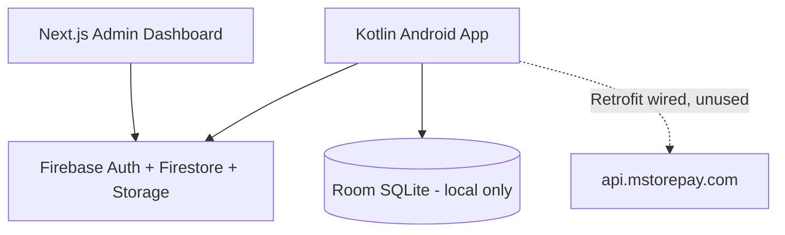
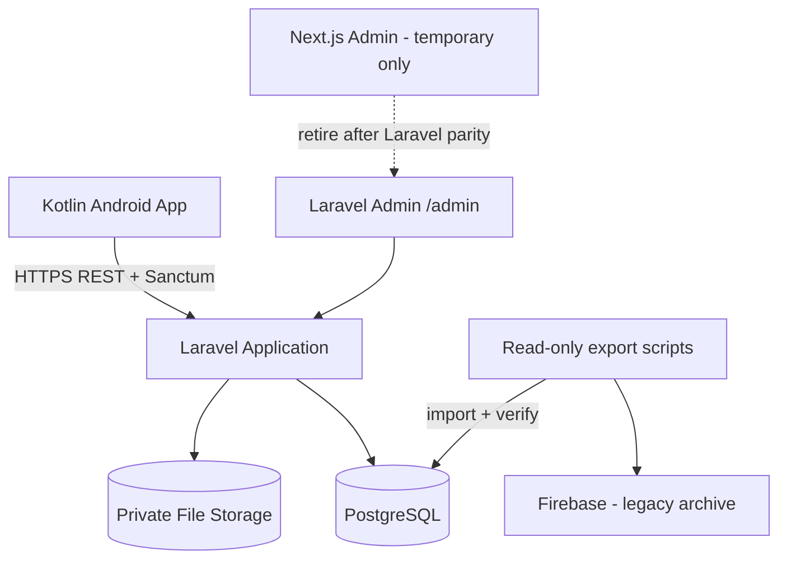

# Laravel Migration Plan — MoMo Kotle

This document describes the **current** system, the **target** architecture, and the **incremental migration plan** from Firebase to Laravel.

**Current progress:** Kotlin mobile uses Laravel REST API for all cloud modules. Laravel `/admin` is the sole admin UI. Legacy Next.js admin and Firebase/Firestore client files removed from the repo. Optional JSON import into PostgreSQL remains via `migration:import-firebase`.

See also: [ARCHITECTURE.md](./ARCHITECTURE.md) for the full existing-system audit.

---

## Migration principles (authoritative)

These rules govern all migration work:

1. **Single runtime backend:** The target system is **Kotlin → Laravel REST API → PostgreSQL**. Laravel is the only authoritative backend for business data, auth, files, commissions, and admin operations.

2. **No Firebase runtime fallback:** Do **not** implement dual-read, feature-flag fallback, or “try Laravel then Firebase” patterns. Once a feature is cut over, it uses Laravel only.

3. **Firebase is legacy data only:** Firebase (Auth, Firestore, Storage) is a **temporary legacy data source** used **only** for one-time export during migration. It is **not** part of the target runtime architecture.

4. **Do not touch Firebase during migration:** Do not delete, rewrite, or mutate Firebase data until required records have been **exported → imported → verified** and the migration is **formally signed off**. Export scripts are read-only against Firebase.

5. **Pure Kotlin + Laravel target:** The mobile app remains Kotlin (Compose, USSD, Room for local-only data). The admin UI migrates to **Laravel `/admin`**. Next.js remains in the repo temporarily until Laravel admin reaches parity — it is **not** part of the final architecture.

6. **Financial logic is server-side:** Commissions, wallets, subscriptions, and referral rules are calculated and enforced in Laravel — never trusted from the client.

---

## 1. Current Architecture



| Component | Location | Backend |
|-----------|----------|---------|
| Mobile app | `app/` | Firebase SDK (direct) |
| Admin dashboard | `admin-dashboard/` | Firebase JS SDK (direct) |
| REST API | `app/.../MStorepayApiService.kt` | Defined but **never called** |
| SQL database | — | **Not implemented** |
| Laravel | — | **Did not exist before this migration phase** |

---

## 2. Target Architecture



**Final state:**

```
Kotlin Mobile → Laravel REST API → PostgreSQL + Private Storage
Laravel Admin (/admin) — sole admin UI
Firebase — decommissioned after formal migration sign-off (not used at runtime)
```

**What Firebase is NOT in the target system:**

- Not a runtime fallback for the Laravel API
- Not a sync layer or secondary database
- Not called by Kotlin or Laravel admin after cutover

## 3. Current Mobile Architecture

| Layer | Package | Notes |
|-------|---------|-------|
| UI | `presentation/*` | Jetpack Compose screens |
| ViewModels | `presentation/*ViewModel.kt` | StateFlow, Hilt |
| Use cases | `domain/usecase/` | USSD, auth, commission, contacts |
| Repositories | `domain/repository/` + `repository/*Impl` | Interfaces + implementations |
| Remote | `data/firestore/*` | All online data |
| Local | `database/*`, `data/datastore/*` | Room + DataStore |

### Verified mobile data flows

**Authentication (Firebase today):**
```
LoginScreen → LoginViewModel → AuthRepositoryImpl
  → Firebase Auth + FirestoreUserDataSource → users collection
  → UserAccountDataStore (cache)
```

**Store order (Firebase today):**
```
StoreViewModel → OrderRepositoryImpl
  → Room (cache) + FirestoreOrderDataSource → storeOrders
```

**Form submission (Firebase today):**
```
AgentFormScreen → FormSubmissionRepositoryImpl
  → FirebaseSubmissionStorage (Storage) + FirestoreFormSubmissionDataSource
```

**USSD transaction (local only — stays on device):**
```
DashboardScreen → DashboardViewModel → RecordAttemptedTransactionUseCase
  → TransactionRepositoryImpl → Room transactions table
  → StartUssdFlowUseCase → UssdDialHelper + UssdAutomationEngine
  → MomoAccessibilityService
```

**MoMo agent commission preview (local — NOT referral commission):**
```
CalculateVendorProfitUseCase → AgentCommissionEngine
  → SettingsDataStore + ProfitRuleRepository (Room)
```

---

## 4. Current Admin Architecture

| Layer | Location | Notes |
|-------|----------|-------|
| Pages | `admin-dashboard/app/dashboard/*` | Next.js 16 App Router |
| Auth | `hooks/useAuth.js` + `firebase/auth.js` | Firebase Auth + `admins` collection |
| Services | `admin-dashboard/services/*.js` | Direct Firestore/Storage |
| Guard | `DashboardShell.jsx` | Client-side redirect |

### Verified admin data flows

**Admin login:**
```
LoginForm → useAuth.login → loginAdmin()
  → Firebase Auth → checkIsAdmin(admins/{uid})
```

**Order commission:**
```
orders page → processOrderCommission() in commissionEngine.js
  → Firestore transaction: wallets, wallet_transactions,
     commission_transactions, revenue_transactions, notifications
```

---

## 5. Current Database / Data Sources

### Firestore collections (shared)

| Collection | Mobile | Admin |
|------------|--------|-------|
| `users` | R/W own | R/W all |
| `admins` | — | Auth gate |
| `storeProducts` | Read | CRUD |
| `storeOrders` | Create own | R/W all |
| `form_submissions` | Create own | R/W all |
| `wallets`, `wallet_transactions` | R own | R/W all |
| `subscriptions`, `subscription_plans` | R/W own | CRUD |
| `referrals` | R own | R all |
| `withdrawal_requests` | Create own | Approve |
| `commission_transactions`, `revenue_transactions` | — | Admin only |
| `notifications` | R own | Create |
| `business_settings`, `appSettings` | Read | Write |
| `audit_log` | — | Write (rules gap) |
| `payments`, `counters` | W | Partial |

### Room (mobile local only — NOT migrating to Laravel)

| Table | Purpose | Migration |
|-------|---------|-----------|
| `transactions` | USSD attempts/results | **Stays local** |
| `profit_rules` | MoMo tier rules | **Stays local** |
| `saved_contacts` | Contact book | **Stays local** |
| `custom_flows` | Custom USSD menus | **Stays local** |
| `store_orders`, `form_submissions`, `store_products` | Firebase cache | Replace cache source with Laravel API |

---

## 6. Current Firebase Usage

| Service | Mobile | Admin |
|---------|--------|-------|
| Firebase Auth | Email/password agents | Email/password admins |
| Firestore | Primary backend | Primary backend |
| Storage | `agent_uploads/{userId}/{submissionId}/` | `products/`, submissions |

Rules examples: `firestore.rules.example`, `storage.rules.example` (repo root).

---

## 7. Current Authentication

| Client | Mechanism | Authorization |
|--------|-----------|---------------|
| Mobile | Firebase Auth UID | Firestore rules + subscription gating |
| Admin | Firebase Auth UID | `admins/{uid}` document existence |

Laravel foundation introduces **parallel** auth (not yet wired to mobile/admin):

| Client | New mechanism |
|--------|---------------|
| Mobile API | Laravel Sanctum bearer tokens (`/api/auth/*`) |
| Laravel admin | Session auth + `users.role = admin` |

During transition, Laravel foundation exists **in parallel** with the legacy Firebase-backed clients. Legacy clients continue to use Firebase **only until** each module is cut over to Laravel — not as a fallback for Laravel.

---

## 8. Current Storage

| Path | Owner | Sensitivity |
|------|-------|-------------|
| `agent_uploads/{userId}/{submissionId}/{file}` | Mobile upload | Private |
| `products/{productId}/` | Admin upload | Authenticated read |
| `submissions/{submissionId}/` | Legacy | Admin read |

Laravel target: `storage/app/private/agent_documents/{user_id}/{application_id}/` with authorized download routes.

---

## 9. Current Business Logic (must move server-side)

| Logic | Current location | Trust level |
|-------|------------------|-------------|
| Referral registration + trial | `BusinessRegistrationService.kt` | Client-initiated Firestore transaction |
| Subscription purchase | `BusinessRepositoryImpls.kt` | Client-initiated |
| Order commission (referral 40/60) | `admin-dashboard/services/commissionEngine.js` | Admin browser |
| Wallet withdrawal approval | `admin-dashboard/services/withdrawals.js` | Admin browser |
| MoMo USSD commission estimate | `AgentCommissionEngine.kt` | **Local only — OK to stay** |
| Subscription access level | `UserBusinessProfile.resolveAccessLevel()` | Derived on client — must move to API |
| Product profit splits | Firestore product docs | Admin-managed, but applied in JS |

### Business rules to preserve (configurable, not hardcoded)

- Referral: 40% referrer / 60% system (default; per-product overrides exist)
- Monthly subscription bonus: 1 GHS per active referred user
- Trial period: configurable (`business_settings.trial_days`, default 7)
- Subscription plans: DB-seeded defaults (1/3/6/12 months)
- Product profit defaults: seeded in Laravel `DatabaseSeeder`

---

## 10. Current API Communication

| Client | Active API | Status |
|--------|------------|--------|
| Kotlin | Firebase SDK | **Production** |
| Kotlin | `MStorepayApiService` → `api.mstorepay.com` | **Dead code** (DI only) |
| Next.js | Firebase SDK | **Production** |
| Next.js | Laravel | **Not connected** |

---

## 11. Components That Can Be Reused

| Component | Reuse strategy |
|-----------|----------------|
| Kotlin UI / ViewModels / USSD | Keep; replace Firebase repositories with Laravel API repositories |
| Kotlin Room (USSD, contacts, profit rules) | Keep unchanged (local-only) |
| Kotlin domain interfaces | Keep; Laravel-backed repository implementations only after cutover |
| Next.js admin | Temporary legacy UI — retire when Laravel `/admin` has parity |
| Firestore data | **Read-only export** → PostgreSQL import → verify (Firebase untouched until sign-off) |
| `commissionEngine.js` logic | Port to Laravel services (server-authoritative) |
| `BusinessRegistrationService.kt` flow | Port to Laravel registration service |
| Retrofit / `NetworkModule` | Reuse for Laravel API — single HTTP client |

---

## 12. Components That Need Migration

| Priority | Component | From | To |
|----------|-----------|------|-----|
| P1 | User registration/login | Firebase Auth | Laravel Sanctum |
| P1 | User profile + trial | Firestore `users` | PostgreSQL `users` |
| P2 | Products catalog | Firestore `storeProducts` | `products` table |
| P2 | Store orders | Firestore `storeOrders` | `orders` table |
| P2 | Agent applications | Firestore + Storage | `agent_applications` + private storage |
| P3 | Wallets + withdrawals | Firestore | `wallets`, `withdrawal_requests` |
| P3 | Subscriptions | Firestore | `subscriptions`, `subscription_plans` |
| P3 | Referrals | Firestore | `referrals` |
| P4 | Commissions + revenue | Firestore | Server-side Laravel transactions |
| P4 | Notifications | Firestore | `notifications` table |
| P4 | Business/app settings | Firestore | `business_settings`, `app_settings` |
| P5 | Admin UI | Next.js | Laravel `/admin` (incremental) |
| P5 | Audit log | Firestore | `audit_logs` |

---

## 13. Components That Should Remain Temporarily

| Component | Reason |
|-----------|--------|
| Next.js admin | Temporary until Laravel `/admin` reaches feature parity — **not** final architecture |
| Legacy Firebase-backed Kotlin repositories | Remain **only until** each module is replaced with Laravel API repositories (no dual-runtime) |
| Firebase project (untouched) | Legacy data archive until export/import/verification complete |
| `MomoAccessibilityService` / USSD engine | Device-local; no backend dependency |
| Room `transactions`, `profit_rules`, `custom_flows` | Local agent tooling — stays on device |
| Retrofit `NetworkModule` | Reuse for Laravel API (single HTTP client) |

**Do NOT keep:**

- Firebase as a runtime fallback for Laravel
- Dual-read or feature-flag “Laravel OR Firebase” repository implementations
- Next.js → Firebase as a long-term admin path

## 14. Risks and Issues Discovered

1. **Dual commission systems** — Local MoMo commission vs cloud referral commission are unrelated; do not merge incorrectly.
2. **Unused Retrofit client** — Suggests prior API plan; reuse for Laravel rather than adding another HTTP layer.
3. **Client-trusted financial logic** — Commission and wallet updates currently run from admin browser JS; must be server-authoritative in Laravel.
4. **`audit_log` missing from Firestore rules example** — Security gap in current system.
5. **Legacy collection names** — `formSubmissions` vs `form_submissions` dual-read paths.
6. **Destructive Room migrations** — Local USSD history lost on schema bump (unchanged by Laravel work).
7. **No `.env.example` in admin-dashboard** — Onboarding friction.
8. **Firebase UID mapping** — Laravel `users.firebase_uid` column supports import reconciliation only.
9. **Cutover coordination** — Modules must not go live on Laravel until imported data for that module is verified.

---

## 15. Recommended Migration Order

Migration is **incremental by module**, but each module has a **hard cutover** — not a dual-runtime fallback.

### Phase 0 — Foundation ✅ (complete)

- [x] Create `laravel/` application
- [x] Database migrations from actual Firestore model
- [x] Sanctum mobile auth skeleton
- [x] Admin session auth skeleton (`/admin`)
- [x] Seed business settings, plans, products, admin user
- [x] Documentation

### Phase 1 — Export & import pipeline (in progress)

- [x] Read-only Firebase export script (`scripts/firebase-export/`)
- [x] Laravel import command (`migration:import-firebase`) — idempotent upsert
- [x] Verification command (`migration:verify-firebase`) — manifest vs PostgreSQL counts
- [x] Sample fixture + automated tests
- [ ] Run export against production Firebase (requires service account — operator task)
- [ ] Import to production PostgreSQL and sign off verification report
- [ ] Configure production `DB_CONNECTION=pgsql`

### Phase 2 — Laravel API + Kotlin cutover (per module)

For each module (auth → products → orders → applications → wallet → subscriptions → referrals → notifications):

1. Implement Laravel API endpoints (authoritative writes + reads)
2. Replace Kotlin `Firestore*DataSource` with `LaravelApiDataSource` via existing Retrofit client
3. Remove Firebase SDK usage for that module from Kotlin DI
4. Run UAT against Laravel + PostgreSQL only
5. **No Firebase fallback** — if Laravel fails, fix Laravel; do not route to Firebase

### Phase 3 — Server-side business logic

1. Port `commissionEngine.js` to Laravel `OrderCommissionService`
2. Wallet, withdrawal, subscription, and referral bonus transactions in Laravel
3. All financial values computed server-side from `business_settings` and product config

### Phase 4 — Laravel admin parity

1. Migrate admin features to Laravel `/admin` one module at a time
2. Retire Next.js when parity + UAT complete
3. Next.js is not wired to Laravel as a permanent adapter — it is deprecated

### Phase 5 — Formal Firebase decommission (after sign-off)

**Prerequisites (all required):**

- [ ] All modules running on Kotlin → Laravel → PostgreSQL in production
- [ ] Export/import verification report signed off
- [ ] No production client reads or writes Firebase
- [ ] Laravel admin fully replaces Next.js

**Then only:**

1. Archive final Firebase export snapshot
2. Remove Firebase SDK from Kotlin and retire Next.js
3. Document decommission date — Firebase project may remain read-only archive for compliance

---

## 16. Laravel Project Location

**Chosen path:** `laravel/` at repository root

**Rationale:**

- Does not conflict with Android `app/` module
- Does not conflict with `admin-dashboard/`
- Standard monorepo layout: `app/`, `admin-dashboard/`, `laravel/`, `docs/`
- Independent Composer/Artisan lifecycle
- Deployable as subdirectory on shared hosting (`public/` → web root)

---

## 17. What Was Created in Phase 0

| Item | Path |
|------|------|
| Laravel 13 app | `laravel/` |
| API routes | `laravel/routes/api.php` |
| Admin routes | `laravel/routes/admin.php` |
| Migrations | `laravel/database/migrations/2026_09_05_*` |
| Models | `laravel/app/Models/*` |
| Services | `CommissionCalculator`, `SubscriptionAccessService`, `BusinessSettingsService` |
| API auth | `AuthController`, Sanctum tokens |
| Admin auth | Session login at `/admin/login` |
| Tests | `tests/Feature/ApiAuthTest.php` (6 passing) |
| Seed data | Plans, products, business settings, admin user |

**Default admin (local seed only):** `admin@momokotle.test` / `password` — change in production.

---

## 18. Deliberately Untouched

- `app/` (Kotlin) — no source changes
- `admin-dashboard/` — no source changes
- Firebase project data
- `firestore.rules.example`, `storage.rules.example`
- USSD / AccessibilityService code
- Existing `docs/ARCHITECTURE.md` (referenced, not replaced)

---

*Last updated: September 2026 — Laravel admin parity complete (audit log included). Next.js retirement pending UAT.*
